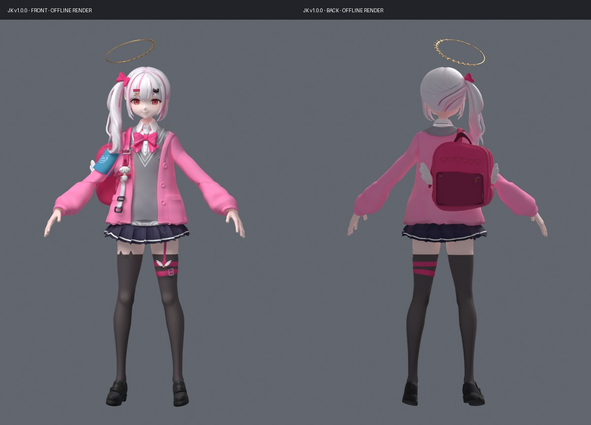

# 岁己 × 影之刃零

成年「魂」的完整岁己角色替换 MOD：脸、头发、身体和服装，仅由 **黑伤（逃亡）** 外观启用。不处理少年魂。本仓库收录当前可用模型、可安装模型包、制作经验和 Codex skill。

2026-11-14，用户已报告 `native-shaders-v1` 模型实机成功。测试游戏为 Steam app **4115450**、build **26367565**。这不是全流程兼容性认证：战斗、武器、过场、长时间游玩仍需逐项验证；游戏更新后应重新核验。

当前正式版为 [岁己JK服有外套侧马尾_影之刃零主角替换MOD · jk-v1.0.0](https://github.com/Yuiffy/phantom-blade-zero-sui-mod/releases/tag/jk-v1.0.0)，使用 **物理细修 v3**：JK 服、外套、侧马尾、背包和白猫吊饰，包含马尾与挂饰摆动及受限衣摆、裙摆、包体物理。v3 将独立内衬裤脚上收约 6 cm，保留原腿部、裙子和已调物理。2026-11-15 已核对安装哈希，用户反馈“不错哦”并批准发布；这不代表所有武器、动作和过场均已验证。见 [发布说明与清单](releases/jk-v1.0.0/release-notes.md)、[v3 模型与源码](models/jk-motion-v3-candidate/README.md)、[安装摘要](evidence/jk-motion-v3-offline/installation-summary.json)。独立 Compact v5 语音包字节保持不变。



**已知问题与本地修复：**用户反馈正式版 v3 在低角度下裆部露出肉色。现已制作并安装 [v4 安全裤遮挡修复](models/jk-motion-v4-candidate/README.md)：恢复完整裆底及两个独立裤口，裤脚比 v3 回落约 2 cm，内部增加不透明黑色遮挡。离线姿势、物理和成品容器核验通过，游戏试玩待反馈；GitHub 正式 Release 尚未更新。

[v11 静态细修候选](models/jk-v11-candidate/README.md) 包含裙子残留粉色清理、清晰猫脸袜和另一侧袜口、手指体积及实际背带吊点，保留为静态回退。基于它的 [物理实验 v1](models/jk-motion-v1-candidate/README.md) 已通过真实离线 Chaos 模拟及最终容器读回，并已安装获用户初步试玩反馈。物理预览是离线求解结果。

历史源与证据保留：[v8 肩颈和比例](models/jk-v8-candidate/README.md)、[v9 手部转轴与饰件](models/jk-v9-candidate/README.md)、[v10 右背与包内投影](models/jk-v10-candidate/README.md)。候选目录中的旧状态文字记录当时检查阶段；当前安装事实以上述物理 v3 凭据为准。人工诊断姿势不能保证实际长柄防御或所有动作无穿插。

## 安装模型

从 [JK 正式版 Release](https://github.com/Yuiffy/phantom-blade-zero-sui-mod/releases/tag/jk-v1.0.0) 下载 `Sui_JK_Cardigan_SidePonytail_PBZ_v1.0.0.zip`，解压。关闭游戏，先备份并移出本项目旧模型三件套，保留独立语音包；再将 `mod/` 下同名的 `.pak`、`.utoc`、`.ucas` 三件套放入：

```text
<PBZ游戏目录>/ProjectPBZ/Content/Paks/~mods/
```

进入游戏选择黑伤（逃亡）。不要混装本项目旧版或修改同一外观表的 MOD。

也可用 Python 3.10+ 执行带哈希核验的安装工具。以下命令从解压目录运行；默认只预览，加 `--apply` 才写入：

```powershell
python scripts/mod_files.py verify --manifest manifest.json
python scripts/mod_files.py install --manifest manifest.json --game-root '你的PBZ游戏目录'
python scripts/mod_files.py install --manifest manifest.json --game-root '你的PBZ游戏目录' --apply
```

脚本要求 Windows、Steam 目录结构和本次已验证的 build；不会启动、停止或操作游戏。卸载使用同一解压目录保存的凭据，核对哈希后只删除本包文件：

```powershell
python scripts/mod_files.py uninstall --manifest manifest.json --game-root '你的PBZ游戏目录' --apply
```

手动卸载也只需移除 `z_Sui_HeiShang_JK_Motion_v3_P` 的三个文件。不要清空整个 mods 目录、删缓存或改存档。

## 模型与制作经验

- [v11 细修候选：裙色、两侧袜口、手指体积与吊点](models/jk-v11-candidate/README.md)：离线核验完成，尚未安装；真实摆动物理未加入此包。
- [物理实验 v1 源码、模型和验证边界](models/jk-motion-v1-candidate/README.md)、[实际离线模拟动图](evidence/jk-motion-v1-offline/motion-preview.gif)
- [物理细修 v2：贴图、光环、重力马尾与挂饰避让](models/jk-motion-v2-candidate/README.md)、[离线模拟动图](evidence/jk-motion-v2-offline/motion-preview.gif)：三组模拟及最终容器读回通过，用户反馈整体不错；现保留为本地回退。
- [物理细修 v3：缩短黑色内衬裤脚](models/jk-motion-v3-candidate/README.md)：保留腰臀与裆部覆盖，裤脚上收约 6 cm；三组模拟及最终容器读回通过，用户认可并批准作为 JK 首个正式版发布。
- [v10 安装凭据摘要与用户试玩反馈](evidence/jk-v10-installation/installation-summary.json)
- [绑定后的旧衣服 GLB](models/sui-hun-binding.glb)：早期公开 Release 的几何和绑定，内嵌贴图，可导入 Blender；新衣 JK 源码见上述候选目录。
- [模型说明与来源](models/README.md)
- [v7 候选：肩颈权重、颈长与下摆衔接](models/jk-v7-candidate/README.md)
- [制作 skill](skills/pbz-character-mod/SKILL.md)
- [闪退诊断与修复](skills/pbz-character-mod/references/model-pipeline.md)
- [原声语音替换](skills/pbz-character-mod/references/voice-pipeline.md)
- [实测范围与数据](evidence/runtime-result.json)
- [v7 离线核验数据](evidence/jk-v7-offline/summary.json)

将 `skills/pbz-character-mod/` 复制到 `~/.codex/skills/pbz-character-mod/`，可使用 `$pbz-character-mod`。Skill 包含本次验证过的约束和可移植核验工具；不包含游戏解密密钥、提取的原版资产、第三方工具或全自动重建流水线。

## 语音实验

用户反馈 v1 跳攻仍是男声后，已定位到实际技能引用的漏项并安装原声实验 v2。检查了 49 个空中/跳跃技能及其父类，共 66 个资源；五组直接空中发声的 33 个独立媒体现均有替换。新包共 26 事件、134 个媒体替换，使用 20 段既有按钮原声；其他所选事件仍保留 95 个原声媒体。**v2 待再次游戏实测与听审**，详情见 [跳攻漏项案例](skills/pbz-character-mod/references/voice-jump-case.md)。剧情对白、英语、少年魂保持原样，检查范围不代表所有地面连段。

语音事件为成年魂共享，**不限定黑伤（逃亡）服装**。没有 TTS、CosyVoice、变声、新 ASR 或人声分离。切口、背景声、音量和语气仍待听审。语音实验与稳定模型分开回退；本次公开 Release 仅包含模型，仓库公开语音方法和来源索引，不打包私人录播或未听审音频。

## 致谢与使用范围

方法参考 [ccd775/GameModdingKnowledge](https://github.com/ccd775/GameModdingKnowledge) 的 PBZ 技术记录，以及 [StarryNightSquad/Phantom-Blade-Zero](https://github.com/StarryNightSquad/Phantom-Blade-Zero) 的作者经验。具体适用性与版本差异见 [案例记录](skills/pbz-character-mod/references/case-2026-11-14.md)。本仓库未复制它们的代码或资产。

岁己为相关权利方的角色；影之刃零及游戏派生内容的权利属于其各自权利方。本仓库是非官方同人实验。原创脚本与文字按 [LICENSE](LICENSE) 许可；该许可不覆盖角色形象、模型、贴图、语音或游戏派生 MOD 数据。详见 [NOTICE](NOTICE.md)。
