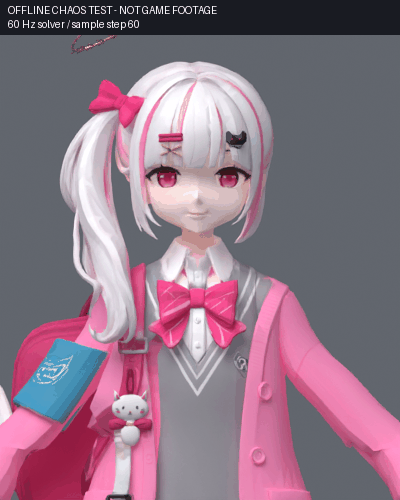

# 岁己 JK 物理实验 v1

2026-11-15，PBZ build 26367565，成年魂「黑伤（逃亡）」。基于 v11 静态细修，**已完成真实离线 Chaos 模拟、最终容器独立读回和模拟表面重建，已于 2026-11-15 17:31:28 安装并核对哈希。用户试玩反馈“感觉还不错哦”，明确确认白猫挂饰可以摆动，但有时陷进衣服；另提出袜口、皮肤和手心色差。** 语音包未改。见 [安装和反馈摘要](../../evidence/jk-motion-v1-offline/installation-summary.json)。

## 已制作

马尾使用固定发根的低分辨率导向网格；立体发束、前垂方向和原有几何保留。白猫挂饰沿真实背带吊点固定，六个颜色/表面响应分区合成一个 albedo/ARM 图集，避免模拟后五官或蝴蝶结离开本体。裙摆、针织外套下摆和包体分别使用受限模拟；裙子保留安全内衬，位移上限 0.65 cm，避免大幅上翻。

没有添加角色骨骼、发丝着色器或 Groom；仍用经验证的原生父材质。头颈、肩背、手、腿及其他 v11 可见几何/蒙皮保持原样。v11 的裙色、袜饰/袜口、手指体积和挂点细修均包含在本地物理候选。

| 项目 | 核验结果 |
| --- | --- |
| 可见几何 | 35,402 源顶点、69,041 三角面；位置与权重相对 v11 不变 |
| 模拟 | 1,745 粒子、五组 cloth，导向网格渲染禁用 |
| 骨架 | 原 264 骨，参考变换逐项核对 |
| 包与材质 | 57 packages、19 可见材质槽，无自制 shader |
| 含隐藏导向网格 | 37,147 源顶点、72,305 三角面 |
| 碰撞 | 独立 cloth-only PA，十个运动学球；身体原 gameplay/ragdoll PA 保留 |

## 离线验证与实际限制

官方 UE 5.7.4 的同步 Chaos 求解器在参考姿势下，分别测试 60 Hz/15 cm 与 30 Hz/25 cm 横移及偏航。两组均检查粒子有限性、固定区、MaxDistance、边长范围和可测运动。输入不同，不能把它们当成帧率无关性测试；没有使用提取的游戏动画。

由最终 cooked 单 influence GPU 映射和实际 60 Hz 模拟数据重建可见表面，最大相对静止位移：马尾约 3.45 cm、白猫约 1.95 cm、衣摆约 0.51 cm、裙摆约 0.19 cm、包体约 0.28 cm。首帧最大重建偏差约 0.289 cm。动画预览保留采样时间，并明确标为离线结果。

最终 IoStore 经独立 CUE4Parse 和 bounded native reader 核对：cloth 资产/GUID/索引、粒子与三角面、MaxDistance、序列化 config、碰撞体、禁用导向分区、GPU cloth buffer、原骨架、量化蒙皮、外观表、原生叶子 MI 及 VT payload。配置中省略的类默认值不证明与 PBZ 定制引擎默认值相同。最终 VT 尚未独立解码到像素。见 [验证摘要](../../evidence/jk-motion-v1-offline/candidate-summary.json)。

**白猫挂饰在游戏中的摆动已由用户明确确认；马尾、各类战斗/过场动画、瞬移、LOD 和性能未获逐项确认。** 用户已报告挂饰偶发穿衣，仍需细修；测试包保留独立三件套及 v10/v11 静态回退，不作为稳定 Release 发布。

## 源文件与构建前提

Blend 内嵌贴图；FBX 外部图见 `textures/`。`manifest.json` 记录源文件字节与哈希。源模型和角色形象不属于代码 MIT 许可，见仓库 NOTICE.md。

作者工程需自行准备合法提取的 Skeleton/原 PA/原 post-process 模板、原生 MI 模板、映射文件和工具。原游戏资产、密钥、最终容器及编译二进制不在公开仓库。脚本保留本机目录布局，迁移时须调整 PBZ 根、v11 基线和 UE/Blender/工具路径；不是开箱即用流水线。

在本机布局中，源准备顺序是 `prepare_motion_source_dense.py` → `prepare_project.py` → `consolidate_charm.py` → Blender 执行 `consolidate_charm_blender.py` 和 `audit_source.py`。之后用 `run_ue.py` 的 import/cloth/test/cook 阶段、验证脚本和模型打包脚本。`prepare_project.py` 会重建输入配置，不应在最终候选上随意重跑。

`editor-tools/PBZModTools` 是编辑器辅助源码。经实际 MSVC 14.44.35230、Windows SDK 22621、NetFx SDK 4.8 编译；只在作者工程启用。其中 `BindExistingClothToSlot` 是失败原型，UE rebuild 会丢额外绑定，**本候选禁止使用**；实际脚本要求一个模拟资产对应一个可见分区。经验见 [skill 案例](../../skills/pbz-character-mod/references/jk-cloth-case.md)。
