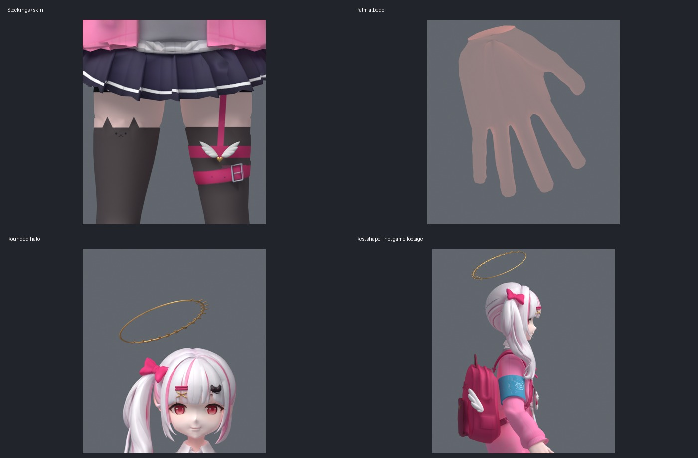
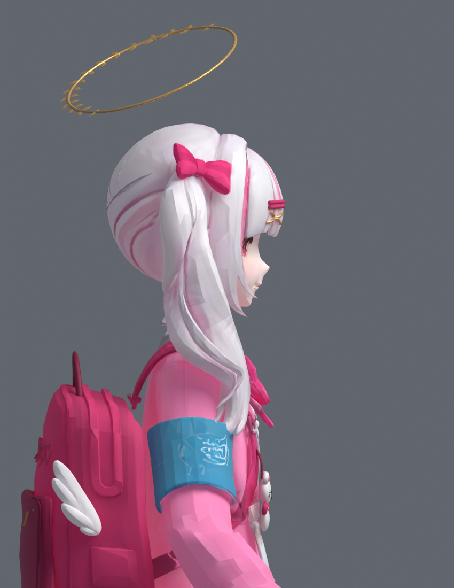

# 岁己 JK 物理细修 v2

2026-11-15，PBZ build 26367565，成年魂「黑伤（逃亡）」。**已安装并核验哈希；v2 尚未游戏实测。** v1 的白猫摆动和少量马尾摆动已获用户确认；用户指出偶发挂饰穿衣、袜口/皮肤/手心色差、扁光环及马尾默认前倾，本版针对这些反馈修复。

## 修改

- 袜面上段与袜身连续补色，统一裸露大腿肤色，保留猫耳猫脸、粉色吊带、两条横带与扣环。清理手心和手指原有硬烘焙阴影；手部几何和权重不变。肤色区使用同一 UV 的粗糙度 mask，继续复用原生父材质，无自制 shader。
- 光环中心线约 31.19 × 29.63 cm，代替约 31.19 × 10.93 cm 的扁椭圆；保留倾斜朝向，叶饰作为刚性部件沿新环重新定位，不整体拉长叶片。
- 马尾高处发根不变，下段默认向后、向外、向下调整；仍使用平面 guide。增大 MaxDistance、重力与惯性，降低恢复原形的驱动和弯曲刚度，保留定型发束外观。它是受限布料导向物理，不是 Groom 或真实发丝模型。
- 白猫身体向外让开约 1.2 cm，真实背带上端挂点保留；增加六个局部外套碰撞球。细颈部在首轮前后测试中出现压缩，收小碰撞余量并增至 8 次迭代、2 子步后通过同一形状范围检查。

## 验证边界

原 264 骨、全部源蒙皮权重、69,041 可见三角面保留；含 guide 共 72,305 三角面、1,745 模拟粒子、57 包。原身体 gameplay/ragdoll PA、目标服装选择与隐藏部件保留；独立 cloth PA 共 16 球。仅光环、马尾及其 guide、白猫及其 guide 的位置改变；其他部位位置不变。

三组真实离线 Chaos 测试：60 Hz/15 cm 和 30 Hz/25 cm 横移加偏航，以及 60 Hz/20 cm 前后移动加俯仰/侧倾/偏航。三组输入不同，不构成帧率无关证明。检查粒子有限、固定区、MaxDistance 和边长范围。按最终 cooked GPU 映射重建，60 Hz 横移测试可见马尾最大位移约 7.53 cm，白猫约 1.88 cm。静止一秒时马尾 guide 下段相对本版默认形状平均向后约 2.90 cm、向下约 0.74 cm。

猫表面与外套进行前方射线间距测量，三组采样中最小约 0.161 cm，没有猫表面点落到该参考姿势外套前面之后。**这不是所有骨骼动作、战斗动画或过场下无穿模的保证。** `review_contacts.py` 明确保留此限制。

零时间映射误差约 0.285 cm；第一帧已经发生真实 1/60 秒重力积分，位移约 0.342 cm，两者分别核验。不要把真实第一帧运动误记为静态绑定误差。最终容器、cloth GUID/config/碰撞体、GPU mapping、骨架、量化蒙皮及 VT payload 均独立读回。最终 VT 未独立解码到像素。

## 文件与构建

Blend 内嵌颜色贴图；FBX 对应 `textures/` 外部 PNG。颜色图为 4096² UV 图集，手/皮肤的 roughness 使用线性 ARM；它们是作者修复后的输入，非游戏原始提取物。`manifest.json` 记录每个公开源文件字节与哈希。

本机脚本引用 v1/v11 基线与本地合法提取模板，迁移须重新布局目录和工具路径，不是开箱即用工程。`refine_geometry.py`、`repair_surfaces.py` → `run_ue.py import/cloth/test` → `validate_simulation.py` → `run_ue.py cook` → `package_mod.py` → 独立验证与重建脚本。编辑器辅助插件只在作者工程运行，未放入 MOD。不得直接对安装目录运行构建。

本地容器和 ZIP 留作安装/回退，公开仓库只收作者源与证据。角色、纹理、模型和骨架派生文件不适用代码 MIT 许可；见 NOTICE.md。语音未改。本轮没有使用 TTS、桌面捕获或控制游戏。
