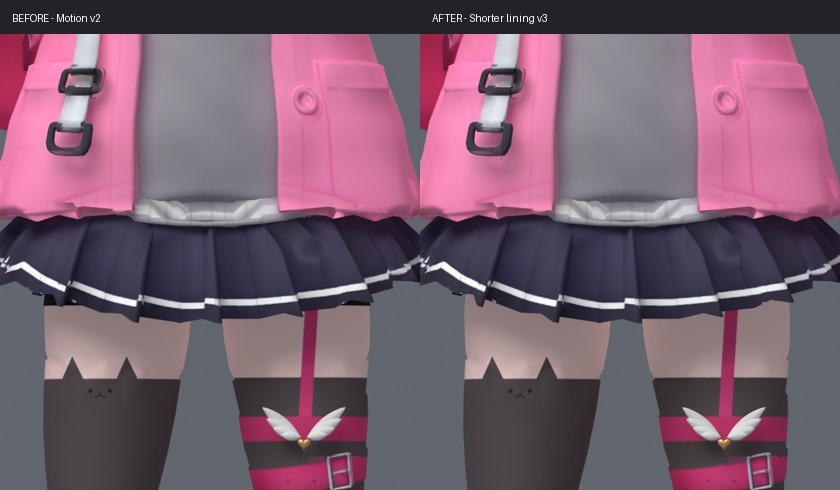

# 岁己 JK 物理细修 v3：缩短内衬裤脚

2026-11-15，成年魂「黑伤（逃亡）」，PBZ build 26367565。已安装并核验哈希，v3 尚未游戏实测。用户反馈 v2 整体不错，但普通视角会露出黑色打底裤裤脚；本版只裁短独立内衬下缘。

裤脚在参考姿势中从 z≈93.985 cm 上收至 100 cm，约缩短 6.015 cm。腰臀、裆部及裁剪平面以上原表面保留；原腿部皮肤、裙子、饰件及物理导向几何/权重不变。新边界按原三角形插值 UV、法线与蒙皮。保留原锐边，Blender 自定义法线重新编码的其他表面最大角差约 0.029°，不是字节完全相同。

原 264 骨及全部保留顶点位置/权重经过检查。可见 68,791 三角面，含禁用 guide 共 72,055 三角面；仍为 57 包、五组 cloth、1,745 粒子。物理网格、配置、mask 和碰撞体与 v2 相同，三组离线运动重新求解通过。最终容器独立读回、量化蒙皮、GPU 映射、父材质及 VT payload 链通过；最终 VT 未独立解码到像素。具体游戏动作下的外观仍待用户确认。

Blend 内嵌原贴图；FBX 使用 [v2 的 textures](../jk-motion-v2-candidate/textures)，图像未经改动，可复制到本地 textures/ 后导入。shorten_lining.py 从本地 v2 作者源做此裁剪，render_shorts.py 生成前后/侧面检查。重建仍依赖本地 UE 作者工程、v2 工具链及合法取得的原版模板，非开箱即用流水线。

v2 已本地备份；独立 Compact v5 语音字节保持。公开目录只含作者源与验证证据，容器与安装 ZIP 留在本地。角色、模型、贴图及游戏骨架派生内容的许可范围见 NOTICE.md，不适用代码 MIT 许可。
