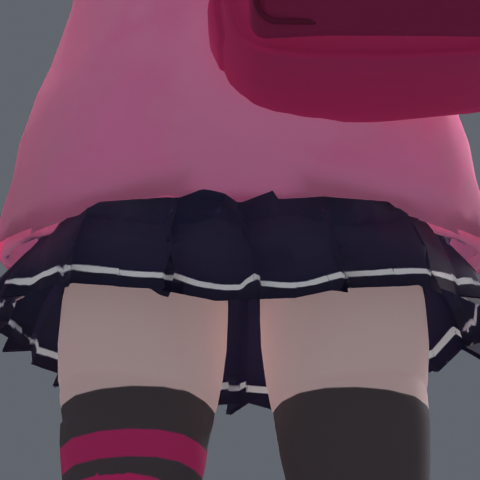

# 岁己 JK 物理细修 v4：完整安全裤遮挡

2026-11-16，成年魂「黑伤（逃亡）」，PBZ build 26367565。已安装并核验哈希，游戏实测待反馈；公开 JK Release 仍为 v3。

v3 用 z=100 cm 水平面裁短裤脚，同时误裁了更低的裆底连接，底部变成横跨两腿的单个大开口。v4 将两侧短裤口统一至 z=98 cm，比 v3 回落约 2 cm，保留连续裆底及一个腰口、两个独立裤口。对应内部表面也使用原有不透明黑色安全裤材质，避免薄层穿插露出肉色。裤口齐平，未保留尖角形的内侧长边。

原腿部位置与权重、裙子、附件和五组物理保持原方案；内部部分皮肤面的材质分配按覆盖区域改变。264 骨，可见 68,950 三角面，含 3,264 个禁用物理导向三角面共 72,214。最终容器 57 包、24 分区，骨架、量化蒙皮、原生父材质和 VT payload 链检查通过；最终 VT 未独立解码为像素。

独立读取器核对最终容器中全部 2,975 个黑色覆盖三角面，角点最大误差约 0.0000205 cm。参考姿势、合成抬腿/分腿/屈腿检查及三组真实离线 Chaos 运动测试通过；五组物理资产的配置、mask、骨权重、物理位置与索引相对 v3 完全相同，GUID 除外。合成姿势不是游戏动画，不代表所有游戏动作均无穿插。

见 [覆盖核验](../../evidence/jk-motion-v4-offline/coverage-final-verification.json) 与 [安装摘要](../../evidence/jk-motion-v4-offline/installation-summary.json)。v3 已备份，独立 Compact v5 语音字节保持。

Blend 内嵌贴图；FBX 仍使用 [v2 的 textures](../jk-motion-v2-candidate/textures)。修复脚本从本地 v2 作者源重建，核对其余表面、UV、权重并导出；法线重新编码的最大角差约 0.029°。重建依赖本地 UE 作者工程、既有工具链及合法取得的原版模板，非开箱即用流程。角色、模型、贴图和游戏骨架派生内容不适用代码 MIT 许可，详见 NOTICE.md。
