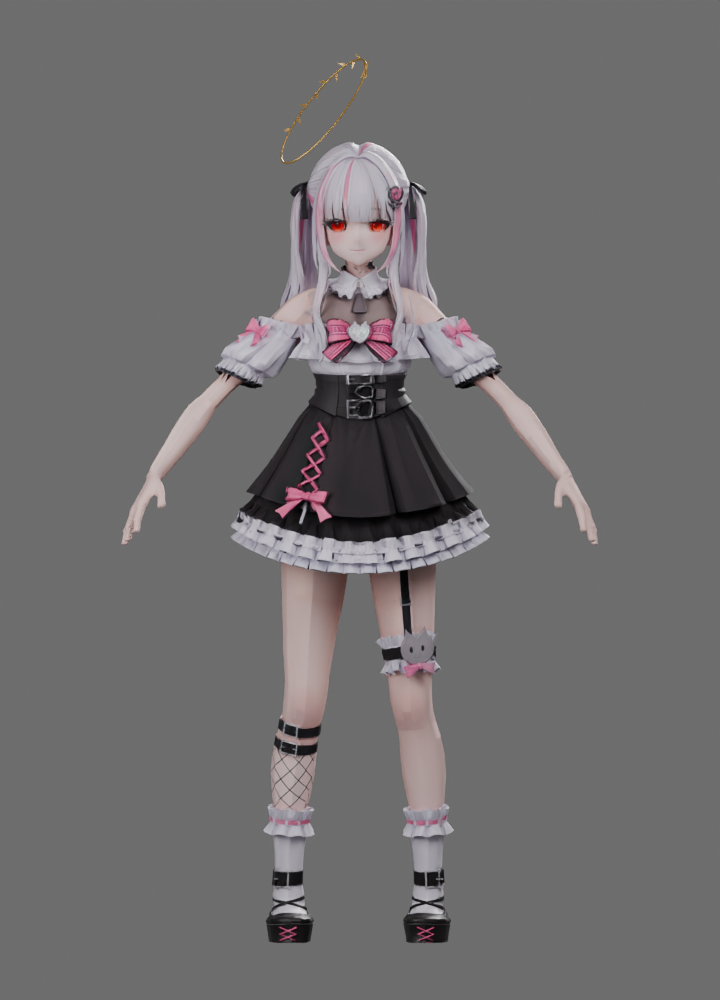
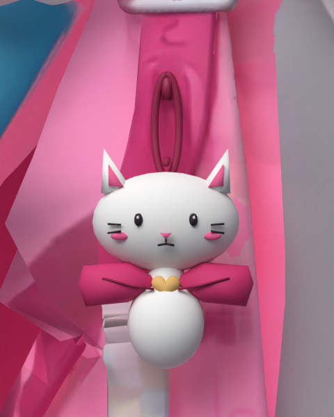

岁己双皮肤合并正式版，直接采用当前已安装、获用户认可并批准发布的 **JK Motion v5＋地雷岁 R5**。下载 **`Sui_JK_Jirai_DualOutfit_PBZ_v1.0.0.zip`**，一个三件套即可安装两套角色。

| 游戏内服装 | 替换皮肤 |
| --- | --- |
| 黑伤（逃亡） | 岁己 JK 服有外套侧马尾（JK Motion v5） |
| 黑伤 | 地雷系双马尾，无翅膀（Jirai R5） |

黑伤内部无帽变体同样使用地雷系。不处理少年魂，保留服装原有解锁条件。

JK 包含马尾、白猫挂饰和受限衣摆、裙摆、包体摆动，修复不透明安全裤覆盖，增加白猫厚度和局部衣服碰撞避让。地雷系包含比例、手部、肩袖与腿根修正，双马尾和裙摆物理，已移除棉花翅膀。

1. 退出游戏，备份并移出本项目旧独立 JK、地雷系或旧双服装模型包，保留独立语音包。
2. 将 ZIP 内 `mod/` 的三个文件一起放入 `<游戏目录>/ProjectPBZ/Content/Paks/~mods/`。
3. 进入游戏，选择上表对应服装。卸载时退出游戏，仅移除 `z_Sui_DualOutfit_JK5_JiraiR5_P` 同名三件套。

无需 Python 或 UE。本包已合并外观表，**不要叠装旧模型或修改同一外观表的其他 MOD**。不含语音，可继续使用独立 [Compact v5 语音包](https://github.com/Yuiffy/phantom-blade-zero-sui-mod/releases/tag/voice-v5-compact-beta.1)。

验证环境：Steam app **4115450**、build **26367565**。最终 88 个资源包经独立读取器核对，两个模型的骨架和渲染数据、布料映射与材质依赖及 68 行合并外观表均已检查；发布模型三件套与已安装版 SHA256 完全一致。用户反馈“不错，可以发布一版release了，直接作为两个皮肤一起发布”。所有动作、武器、过场、长时间运行和其他游戏版本尚未逐项验证；离线测试不保证任何动作下都无穿模。

下图是本项目离线 Blender 预览：地雷系全身、JK 白猫挂饰细节，均非游戏截图。

ZIP SHA256：`252aae5f8643a6de607b55717e080263fee0f83dd510a0811ee10a2070efc168`。另附 `SHA256SUMS.txt` 与 `manifest.json`；包内含安装说明、校验清单和来源说明。模型、角色、贴图及游戏派生数据不适用代码 MIT 许可，详见包内 `NOTICE.md`。
