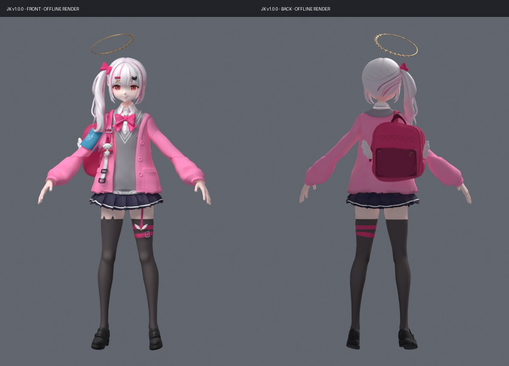

岁己单马尾 JK 新衣的首个正式发布版，采用当前已安装并获用户认可的模型。**仅替换成年魂「黑伤（逃亡）」服装。**

包含 JK 服、外套、侧马尾、背包和白猫吊饰，以及马尾/吊饰摆动和受限衣摆、裙摆、包体物理；收录肩颈比例、手部、袜饰、肤色、光环及缩短内衬裤脚等修正。

下载 **`Sui_JK_Cardigan_SidePonytail_PBZ_v1.0.0.zip`**，无需自行制作模型或安装 Python。

1. 退出游戏，先备份并移出本项目旧模型三件套，保留独立语音包。
2. 将 ZIP 内 `mod/` 的三个文件放入 `<游戏目录>/ProjectPBZ/Content/Paks/~mods/`。
3. 进入游戏选择 **黑伤（逃亡）**。卸载时退出游戏，仅移除本包同名三件套。

不包含语音。语音可按需使用独立 [Compact v5 包](https://github.com/Yuiffy/phantom-blade-zero-sui-mod/releases/tag/voice-v5-compact-beta.1)。不要混装旧模型或修改同一外观表的其他 MOD。

验证环境为 Steam app **4115450**、build **26367565**。最终容器、骨架、蒙皮、原生材质与贴图链检查及三组离线物理测试通过；用户对当前版本反馈“不错哦”并批准发布。所有武器、动作、过场及长时间稳定性未逐项验证，其他游戏版本须重新核验。预览图为离线渲染。

SHA256（ZIP）：`f01075a83586588c571a4ad75f2e101c8df53f443cf8a5013781edbae339d767`。同时提供独立 `SHA256SUMS.txt`，包内附三个模型文件的逐项清单。

模型、角色、纹理及游戏派生内容不适用代码 MIT 许可，来源与使用范围见包内 `NOTICE.md`。
